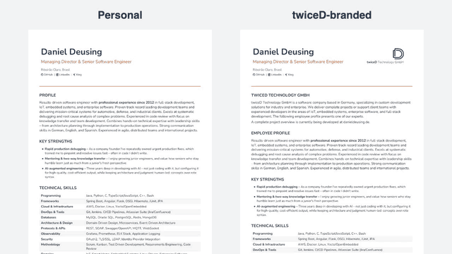

# CV Generator

Generates Daniel Deusing's CV as DOCX and PDF in four languages — German,
English, Spanish, Portuguese — from one JSON file per language.



## Quick Start

```bash
npm install
./generate_all.sh   # every language and variant, DOCX + PDF
```

Build a single CV:

```bash
node create_cv.js en --personal   # personal English → Daniel_Deusing_EN.docx
```

(swap `en` for `de`, `es`, or `pt`)

## How it works

- **Content** lives in `data/cv.{de,en,es,pt}.json` — one identical schema per
  language and the single source of truth (also consumed by the website).
- **Layout** lives in `create_cv.js` — styling only.

To change the CV, edit the JSON and regenerate. To change the look, edit
`create_cv.js`.

## Variants

Each language builds two variants from the same content:

- **personal** (`--personal`) → `Daniel_Deusing_<LANG>.docx`
- **twiceD-branded** (default) → `TD_Daniel_Deusing_<LANG>.docx`, which adds a
  company logo, an intro section and a contact footer

## PDF conversion

`generate_all.sh` converts via LibreOffice headless, so `soffice` must be on
your `PATH` (`brew install --cask libreoffice`). To convert a single file
manually: `soffice --headless --convert-to pdf <file>.docx`.

## Preview animation

The animation above is rendered with [Remotion](https://www.remotion.dev) from
the English PDFs (needs `pdftoppm` from poppler):

```bash
cd video && npm install && npm run render   # → docs/cv-preview.gif
```

## License

The generator code is released under the [MIT License](LICENSE). The CV content
under `data/` and the logos are not covered by that license.
